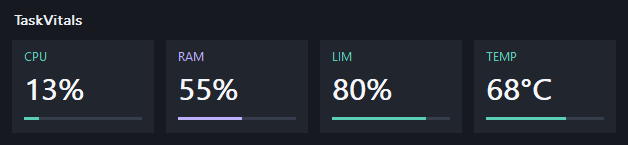

# TaskVitals

[](https://github.com/razbenaharon/TaskVitals/actions/workflows/build.yml)
[](https://github.com/razbenaharon/TaskVitals/releases/latest)
[](LICENSE)

**A small, portable CPU and RAM monitor for the Windows 11 taskbar.**


TaskVitals shows CPU and memory usage as a few readable percentages in a transparent strip over your taskbar. Hover for details, right-click for options. It is one native C++/Win32 executable with an English-only interface, open source under the MIT license.

- **On the taskbar:** CPU and RAM sit in a free gap on the taskbar, placed to avoid your app buttons. You can also switch to draggable desktop cards. The widget hides while a full-screen app is in front on its monitor.
- **Opt-in extras:** [GPU usage, CPU speed limit, CPU temperature and network traffic](#optional-columns) stay off until you turn them on. Temperature needs the separate Core Temp utility.
- **Portable:** one executable of about 88 KiB that runs as your normal user, with no installer, Electron or .NET runtime. TaskVitals itself never needs administrator rights; the optional temperature column relies on Core Temp, which does.
- **Light:** one sampling timer (5 seconds by default), and it repaints only when a shown value changes. With default settings it used about 13 MiB of working set in short observations on one Windows 11 machine. [Resource use](#resource-use)
- **Private:** no telemetry, account or automatic update checks. [What it touches](#privacy-what-taskvitals-touches)
- **Checkable:** open source, with a SHA-256 checksum next to each release download, plus automated MSVC builds and self-tests in CI (separate from the download). [Verify your download](#verify-your-download)

> **New in 1.8.0:** two optional columns, **CPU speed limit** (`LIM`) and **CPU temperature** (`TEMP`), both off by default. This release also adds an application icon, and the widget now hides while a full-screen app is in front on its monitor. See the [changelog](CHANGELOG.md).

## Download

**[Download TaskVitals 1.8.0 for Windows (.zip)](https://github.com/razbenaharon/TaskVitals/releases/download/v1.8.0/TaskVitals-1.8.0-windows-x86.zip)** · [Release notes, checksum and source](https://github.com/razbenaharon/TaskVitals/releases/latest)

1. Download `TaskVitals-1.8.0-windows-x86.zip`, right-click it and choose **Extract all**.
2. Keep the extracted folder somewhere permanent, then double-click `TaskVitals.exe`.
3. Look for **CPU** and **RAM** on your taskbar, by default near the notification area. Right-click the visible text for options, including **Exit**.

TaskVitals needs no installer, account or administrator permission. (The optional temperature column relies on Core Temp, a separate program that asks for administrator approval; see [CPU temperature](#cpu-temperature).) The x86 build is tested on x64 Windows 11. The first CPU percentage appears with the second sample, after 5 seconds by default. The optional columns and **Start with Windows** stay off until you turn them on. Only one copy runs at a time; starting `TaskVitals.exe` again brings the running copy forward.

The ZIP contains `TaskVitals.exe`, `README.txt` (a short plain-text guide), `LICENSE`, `CHANGELOG.md` and `THIRD-PARTY-NOTICES.txt`. `TaskVitals.exe` is 90,112 bytes (about 88 KiB), x86, built with MinGW.org GCC 6.3.0, and **unsigned**, so Windows may warn before it runs a downloaded copy. See [Verify your download](#verify-your-download).

## Read the numbers

| Label | What it shows | Default |
| --- | --- | --- |
| **CPU** | Processor busy time, averaged since the previous sample | Shown |
| **RAM** | Total physical memory in use | Shown |
| **GPU** | Busiest GPU engine across all GPUs ([details](#gpu-usage)) | Off |
| **LIM** | CPU speed limit reported by Windows; not a temperature ([details](#cpu-speed-limit)) | Off |
| **TEMP** | Hottest CPU core in °C, read from Core Temp ([details](#cpu-temperature)) | Off |
| **DOWN**, **UP** | Bytes per second received and sent by the physical network adapters ([details](#network-traffic)) | Off |

- Values are rounded to whole numbers. Temperature shows as `68°` on the taskbar and `68°C` on the desktop cards. Network traffic shows bytes per second in decimal units, such as `0.4K`, `85K`, `12M` or `1.1G`.
- `--` means there is no valid reading yet or the source is unavailable. CPU shows `--` until a second valid sample arrives.
- CPU, GPU and network traffic are averaged over the refresh interval, so a longer interval smooths out their short spikes. RAM and TEMP are read at the moment of each sample.

Hover over the visible text for details: CPU, used, total and available RAM, Windows uptime, the last sample time and the refresh interval. Each optional column you turn on adds its own line. The details are a snapshot, so move away and hover again to update them.


## Customize it

Right-click the visible text to open the menu. Transparent pixels pass mouse input through to the taskbar, so aim at the letters or numbers. There is no tray icon or taskbar button, so this menu is the main control.

| To... | Do this |
| --- | --- |
| Open options | Right-click the visible text, or press **Shift+F10** when the widget has focus |
| See more detail | Hover over the visible text |
| Add an optional column | Check **Show GPU (optional)**, **Show CPU speed limit (optional)**, **Show CPU temperature (needs Core Temp)** or **Show network traffic (optional)** |
| Change text size | **Text size**: Small, Normal (default) or Large |
| Change colors | **Colors**: five presets or custom colors |
| Move it along the taskbar | **Taskbar position**: Right (near notification area, the default), Center of available space, Left (after app buttons) or Custom (Ctrl+drag), plus **Move left** / **Move right**, which nudge it and switch to Custom |
| Pick a custom spot | Hold **Ctrl** and drag the visible text |
| Switch to desktop cards | Uncheck **Taskbar view** |
| Move the desktop cards | Drag anywhere on them |
| Change refresh speed | **Refresh interval**: 1, 2, 5 (default) or 10 seconds |
| Start at sign-in | Check **Start with Windows** (off by default, your user account only) |
| Quit | **Exit**, or **Esc** when the widget has focus |

Your choices are saved and survive a restart. [Settings](docs/SETTINGS.md) lists the registry values.

**Colors.** The presets are Default (mint / lavender), White, Ocean (blue / cyan), Warm (amber / coral) and Dark text (for a light taskbar). **CPU label and bar...**, **RAM label and bar...** and **Percentage text...** open the Windows color picker. The picker loads only while it is open and adds no sampling timer. Colors apply to both views, and the taskbar background stays transparent. The GPU, `DOWN` and `UP` columns use the RAM color, and `LIM` and `TEMP` use the CPU color.

<p>
  
  
</p>

**Placement.** The taskbar view targets the primary horizontal taskbar. TaskVitals uses Windows accessibility to read where the taskbar's buttons and controls are, places itself in a free gap, and moves when app buttons appear or shift. A Ctrl+drag position is a preference, and collision avoidance still applies to it. If no gap fits, or the controls can't be read, the strip sits just above the taskbar. Each optional column widens the strip. **Taskbar position** applies only to the taskbar view.

## Optional columns

Each optional column is off by default, remembered between runs, and adds one column to both views (network traffic adds two). You can turn on any combination. All of them are read at the normal refresh interval, and TaskVitals adds no extra timer, worker thread, service or driver for them. Nothing is sampled while a column is off.



### GPU usage

Check **Show GPU (optional)** to add `GPU`. It shows the **busiest physical engine across all GPUs**. Per-process readings are added up only within the same adapter and physical engine, and the largest engine total is shown. This covers the 3D, compute, copy and video engines that Windows exposes. It is not a sum of all GPUs, a temperature or VRAM usage, and it can differ from Task Manager. The column shows `--` for unsupported drivers, for invalid samples and during the first interval after you turn it on. To retry, turn the option off and on.

Windows' performance-counter library (PDH) loads from the system folder only while GPU or the speed limit is on, and the GPU reader reuses one bounded buffer between samples. Turning GPU off releases its query, buffer and library reference, though Windows may keep other caches. A fresh process with both GPU and the speed limit off does not load PDH.


### CPU speed limit

Check **Show CPU speed limit (optional)** to add `LIM`, read from the Windows **% Performance Limit** counter. Windows describes it as the performance the processor guarantees it can provide, as a percentage of its nominal (base) performance. Windows power policy, the power budget, overheating or other hardware issues can lower it.

- **100%** means nothing is limiting the processor below its base performance.
- **Below 100%** means something is, but the counter does not say which cause applies.
- `LIM` is **not a temperature** and not a clock speed.

Like GPU, it loads PDH only while it is on, and it releases the query and library reference when you turn it off.

### CPU temperature

Windows does not give ordinary programs the CPU temperature. Reading the sensors needs a kernel driver and administrator rights, and TaskVitals installs no driver and never asks for those rights. Instead, check **Show CPU temperature (needs Core Temp)** to add `TEMP`: the hottest core in °C, read from the shared memory that the separate Core Temp utility publishes while it runs.

- TaskVitals opens Core Temp's data read-only on each sample and closes it again, so a closed Core Temp shows `--` instead of an old value.
- If Core Temp is set to Fahrenheit or to distance-to-TjMax, TaskVitals converts the reading to °C. It ignores readings of 0 °C or below and 150 °C or above.
- On the desktop cards, the temperature bar uses a 0–100 °C scale.
- Self-tests check the parser with simulated Core Temp data. The column was also checked live with Core Temp 1.21 on one Windows 11 machine, where it followed Core Temp's hottest core. Because Core Temp updates every second and TaskVitals once per refresh interval, the two can briefly show different values.

> [!IMPORTANT]
> **About Core Temp.** Core Temp is an independent product by ALCPU under its own license. It is free for personal use, and businesses need its commercial license. TaskVitals is not affiliated with or endorsed by ALCPU or Core Temp, and it does not include or redistribute Core Temp. If you use it, download **version 1.21 or later**, and only from <https://www.alcpu.com/CoreTemp/>, because older versions had driver vulnerabilities that were fixed later. Core Temp installs its own driver and asks for administrator approval. TaskVitals itself needs neither.

> [!WARNING]
### Network traffic

Check **Show network traffic (optional)** to add `DOWN` and `UP`: how many bytes per second the computer received and sent, averaged since the previous sample. TaskVitals reads the byte counters that Windows keeps for each network adapter. It sends nothing and runs no speed test, so the columns show the traffic you are using right now, not the maximum speed of your connection.

- Only **physical adapters** count, such as Ethernet and Wi-Fi. Virtual, VPN and filter adapters are left out, because their traffic also passes through a physical adapter and would be counted twice. Loopback traffic never leaves the computer and is not counted.
- Units are decimal bytes per second: `K` is 1,000 bytes/s and `M` is 1,000,000 bytes/s. One `M` is 8 megabits per second, the unit that internet plans and speed tests usually use.
- The column shows `--` during the first interval after you turn it on and when no physical adapter is present. An adapter that appears, disappears or resets its counters adds nothing to that one sample instead of a false spike.
- On the desktop cards, the traffic cards have no bar, because traffic has no natural 100%.
- The hover details also show the **link to the router**: the rate at which the fastest connected physical adapter talks to the router or switch, in Mbps or Gbps, as Windows reports it. It is the ceiling of the local connection, **not your internet speed**, and on Wi-Fi it changes with signal quality.

It loads the Windows IP Helper library only while it is on, and releases it when you turn it off.

> **Temperatures are informational only.** TaskVitals passes readings through from Core Temp. The value on the taskbar strip or desktop cards can be up to one refresh interval old, and the hover details are a snapshot that can be older. TaskVitals gives no overheating warnings. Do not rely on it to protect your hardware.

## Resource use

`TaskVitals.exe` is 90,112 bytes (about 88 KiB). The table shows short observations of version 1.8.0 on one Windows 11 machine. Each mode ran for 30 seconds at Normal size, Right position and the 5-second refresh, with GPU off and Core Temp 1.21 running:

| Optional columns | Working set | Private memory | CPU, whole machine |
| --- | ---: | ---: | ---: |
| None (default) | 13.20–13.25 MiB | 2.54–2.69 MiB | below reported resolution |
| Temperature only | 13.22–13.28 MiB | 2.50–2.68 MiB | below reported resolution |
| Speed limit and temperature | 16.93–16.98 MiB | 6.06–6.21 MiB | 0.0043% |

- The extra memory with the speed limit on comes from loading PDH, which the GPU column also uses. On version 1.7.0, with GPU on, TaskVitals measured 16.25–16.31 MiB of working set and about 0.02% of the machine's CPU.
- Core Temp, if you run it, is its own process. It was observed at about 26 MiB of working set on the same machine, and that cost belongs to Core Temp.
- Working set includes shareable Windows code. Private memory is closer to what the process alone holds. The CPU figures exclude work done by Explorer and the desktop compositor, and "below reported resolution" does not mean no work happened.

These are short observations on one machine, not requirements, limits or guarantees. [docs/PERFORMANCE.md](docs/PERFORMANCE.md) has the raw reports, the method, one earlier outlier run and figures for older versions.

<details>
<summary>How it stays light</summary>

- It uses one ordinary sampling timer and a native Win32 message loop. The window repaints only when a rounded value, or whether it is available, changes.
- Taskbar control positions are cached. Explorer layout events trigger a re-read, which is batched through a one-shot 200 ms timer. There is no periodic scan while the event hook is available.
- PDH loads only while GPU or the speed limit is on. GPU readings reuse one buffer, capped at 4 MiB. Collection runs on the UI thread and can take longer with many GPU processes or a slow performance provider.
- Once per sample, TaskVitals opens Core Temp's shared memory, copies the 2,686 bytes it needs (about 2.6 KiB) and closes it again.
- The color picker library loads on request and is released after the dialog closes.
- Hover details reuse cached samples. There is no background worker, no working-set trimming or forced paging, and no change to global Windows settings.

</details>

## Privacy: what TaskVitals touches

- **Network:** TaskVitals has no telemetry, account system, automatic update checker or app-level network request code. To update, download a newer release from GitHub.
- **Storage:** it keeps preferences under `HKEY_CURRENT_USER\Software\TaskVitals`, plus one `TaskVitals` value in your user's `Run` key if you check **Start with Windows**. It writes no log or data files.
- **Reads:** it reads CPU and memory usage from standard Windows APIs, and taskbar button positions through Windows accessibility so it can avoid covering them. It reads Windows performance counters for GPU and `LIM`, Core Temp's data for `TEMP`, and the network adapters' byte counters for `DOWN` and `UP`, only while those columns are on. Core Temp's data is read locally, through shared memory.
- **System changes:** it installs no driver or service and shows no administrator prompt. It injects no code into Explorer and reserves no taskbar space. Its only shell registration is for full-screen notifications. To hide while a full-screen app is in front, it also listens out-of-process for foreground-window changes, checking only which window is in front and on which monitor, not its contents.

## Verify your download

**Checksum.** Each release publishes a `.sha256` file next to its ZIP. For 1.8.0 it is `TaskVitals-1.8.0-windows-x86.zip.sha256`. Download both files into the same folder, then compare the two hashes in PowerShell. Letter case does not matter.

```powershell
(Get-FileHash .\TaskVitals-1.8.0-windows-x86.zip -Algorithm SHA256).Hash
Get-Content .\TaskVitals-1.8.0-windows-x86.zip.sha256
```

**Unsigned.** `TaskVitals.exe` has no code-signing certificate, so Windows or your browser may warn about a downloaded copy. A matching checksum confirms that your ZIP matches the published file. You can also read the source and [build your own copy](#build-from-source).

**How the download is built.** The release executable is an x86 build made locally with MinGW.org GCC 6.3.0 and tested on x64 Windows 11. It imports only Windows system DLLs. Interactive desktop checks and the resource observations apply to this build. The MSVC and MinGW-w64 builds from [Windows CI](https://github.com/razbenaharon/TaskVitals/actions/workflows/build.yml) are separate from the download.

## FAQ

### Does TaskVitals work on Windows 11?

The x86 build is tested on x64 Windows 11. The taskbar view targets the primary horizontal taskbar. Mixed-DPI setups and secondary or vertical taskbars have not been validated. The widget hides while a full-screen app, such as a full-screen video, is in front on its monitor, and it returns with the taskbar. The Windows secure desktop may still cover it.

### Is it a real taskbar extension? Will it cover my app icons?

It is a topmost window positioned **over** the taskbar, not a shell extension. It does not inject code into Explorer or reserve shell space, and its only shell registration is for full-screen notifications. It reads where the taskbar's controls are and picks a free gap. If no gap fits, or the positions can't be read, it moves just above the taskbar. Placement was checked on the test machine, including the wider GPU view, not on every Windows configuration.

### Does it need administrator access, Electron, Python or .NET?

No. TaskVitals is compiled native C++ that uses Windows system libraries, and it runs as your normal user. PowerShell and CMake are development tools, not runtime requirements. The optional temperature column depends on Core Temp, a separate program that installs its own driver and needs administrator approval. TaskVitals itself never asks for it. Without Core Temp running, that column shows `--` and everything else still works.

### How much memory and CPU does it use?

In short observations on one Windows 11 machine, it used about 13.2 MiB of working set with the optional columns off and about 17 MiB with both the speed limit and temperature columns on. The temperature column also needs Core Temp running, a separate process observed at about 26 MiB on the same machine. With GPU on, version 1.7.0 used about 16.3 MiB. These are measurements, not minimum requirements or fixed limits. See [Resource use](#resource-use).

### How do I turn on GPU monitoring? Does it run while it is off?

Right-click the visible text and check **Show GPU (optional)**. It is off by default. While it is off, no GPU counters are sampled, and a fresh process with both GPU and the speed limit off does not load PDH (the speed-limit column uses PDH too). Turning GPU off closes its query and releases its buffer and library reference, though Windows may keep other caches. See [GPU usage](#gpu-usage).

### Why doesn't TaskVitals read the CPU temperature itself?

Windows does not give ordinary programs the CPU temperature. Reading the sensors needs a kernel driver and administrator rights. TaskVitals installs no driver, so instead it shows what Core Temp already publishes, if you choose to run Core Temp. See [CPU temperature](#cpu-temperature).

### Does a low LIM value mean my CPU is overheating?

Not necessarily. `LIM` is not a temperature. A value below 100% means something is holding the processor below its base performance: Windows power policy, the power budget, overheating or another hardware issue. The counter does not say which, and TaskVitals gives no overheating warnings.

### Why does a column show `--`, or differ from Task Manager?

- **CPU** needs two valid samples.
- **GPU** needs Windows GPU counters, which some drivers do not provide, and one interval to warm up.
- **LIM** needs the Windows performance-limit counter. It shows `--` while it waits for a sample or if the counter is unavailable.
- **TEMP** needs Core Temp to be running and reporting a valid reading.
- **DOWN** and **UP** need one interval to warm up and at least one physical network adapter. Task Manager also counts virtual adapters and shows bits per second, so its numbers can differ.

CPU is averaged between samples, and GPU shows the busiest engine. Because the averaging and aggregation differ, the results can differ from Task Manager.

### Can I change the text, colors, position and refresh interval?

Yes. Right-click the visible letters or numbers for three text sizes, color presets and custom colors, placement options, and refresh intervals of 1, 2, 5 or 10 seconds. The default is 5 seconds. Hold Ctrl and drag the text for a custom position; collision avoidance still applies. See [Customize it](#customize-it).

### Does TaskVitals send telemetry or require an account?

No. It has no telemetry, account system, automatic update checker or app-level network request code. The temperature column reads Core Temp's data locally. Downloads and source are hosted on GitHub, and to update you download a newer release. See [Privacy](#privacy-what-taskvitals-touches).

### Can it start automatically with Windows? How do I quit?

Check **Start with Windows** in the right-click menu. It is off by default and applies only to your user account, and Windows Settings can turn the startup entry off separately. If you move the folder, the menu shows **Start with Windows** unchecked, because the saved entry still points to the old path. Check it once from the new location to register the new path. To quit, choose **Exit** in the same menu.

### Why might Windows warn about the download?

The executable is unsigned. You can compare the ZIP with its published SHA-256 checksum, read the source, or build your own copy. See [Verify your download](#verify-your-download).

### How is it different from TrafficMonitor or a full hardware monitor?

TaskVitals is deliberately narrow: a few percentages on the taskbar, optional GPU, speed-limit, temperature and network-traffic columns, and one portable native executable. It has no history graphs, speed tests, disk activity or VRAM monitoring, and no sensor driver of its own. CPU temperature comes only from Core Temp, when you run it. If you need broad sensor coverage, a dedicated hardware monitor is a better fit. TaskVitals makes no claim to use fewer resources than other tools.

## Remove

Uncheck **Start with Windows**, choose **Exit**, then delete the folder. Preferences are stored under `HKEY_CURRENT_USER\Software\TaskVitals`; delete that key too for a clean removal. If the executable is already gone but startup was on, remove only the `TaskVitals` value under `HKEY_CURRENT_USER\Software\Microsoft\Windows\CurrentVersion\Run`, not the `Run` key itself. Core Temp is a separate program, so uninstall it separately if you no longer need it. See [Settings and removal](docs/SETTINGS.md).

## Build from source

With Visual Studio C++ Build Tools, the Windows SDK and CMake 3.20 or newer:

```powershell
cmake -S . -B build -A x64
cmake --build build --config Release
ctest --test-dir build -C Release --output-on-failure
```

For x86, use `-A Win32` in a separate build directory. With MinGW `g++` and `windres` on `PATH`, `.\build-mingw.ps1` builds `release\TaskVitals.exe`. The release download is built that way.

CTest runs the built-in self-test (`TaskVitals.exe --self-test`), which opens no window and exits with 0 on success. It covers CPU arithmetic, GPU aggregation, taskbar gap selection, Core Temp parsing (Celsius, Fahrenheit, distance to TjMax and invalid core counts) and network counters (adapter filtering, counter resets, link rate and rate formatting), plus a live read of CPU and memory. The interactive scripts in `tests/` need a real desktop session; see [Testing](docs/TESTING.md).

[Windows CI](https://github.com/razbenaharon/TaskVitals/actions/workflows/build.yml) builds MSVC x86 and x64, runs the self-test and packages a ZIP on every push and pull request. CI does not test the taskbar UI.

[Building](docs/BUILDING.md) · [Testing](docs/TESTING.md) · [Settings](docs/SETTINGS.md) · [Performance](docs/PERFORMANCE.md) · [Contributing](CONTRIBUTING.md) · [Changelog](CHANGELOG.md)

## License and notices

TaskVitals is released under the [MIT License](LICENSE). The portable `TaskVitals.exe` statically links small parts of the MinGW.org runtime and the GCC runtime libraries. [THIRD-PARTY-NOTICES.txt](THIRD-PARTY-NOTICES.txt) contains the MinGW.org runtime license notice and an informational note on the GCC Runtime Library Exception. `LICENSE` and `THIRD-PARTY-NOTICES.txt` are both included in the release ZIP. TaskVitals does not include or redistribute Core Temp.

Contributions and small, focused improvements are welcome; see [CONTRIBUTING.md](CONTRIBUTING.md).

**Trademarks.** Windows and Task Manager are trademarks of Microsoft. Core Temp is a product of ALCPU. TrafficMonitor and the other names mentioned here belong to their respective owners. TaskVitals is an independent project and is not affiliated with or endorsed by any of them.
