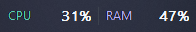
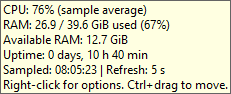
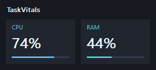
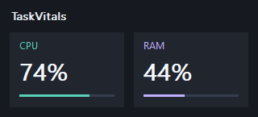
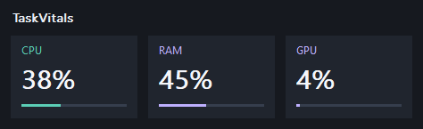

# TaskVitals

**A lightweight, native Windows CPU and RAM monitor, with optional GPU, for your taskbar.**

Keep an eye on system usage with a small transparent strip, hover details, and a configurable refresh interval. Written in C++ with Win32. English-only interface. MIT licensed.



## Download

**[Download for Windows (.zip)](https://github.com/razbenaharon/TaskVitals/releases/download/v1.7.0/TaskVitals-1.7.0-windows-x86.zip)** · [Release notes and source](https://github.com/razbenaharon/TaskVitals/releases/latest)

Choose `TaskVitals-1.7.0-windows-x86.zip`, extract it to a permanent folder, and run `TaskVitals.exe`. The portable x86 build is tested on x64 Windows 11 and needs no separate runtime installation. Startup with Windows is optional and off by default.

Open the ZIP and choose **Extract all**, then double-click `TaskVitals.exe` in the extracted folder. The ZIP contains `TaskVitals.exe`, `README.txt`, `LICENSE` and `CHANGELOG.md`. No installer, account or administrator permission is required. CPU and RAM appear immediately; CPU needs the next sample for its first percentage, and GPU is initially hidden.

The executable is unsigned. Windows may prompt when running a downloaded copy. Source and build instructions are included for anyone who prefers to build it.

## Features

- Transparent CPU and RAM percentages over the taskbar, plus an optional desktop card view.
- Optional GPU utilization, **off by default**, with no GPU sampling or PDH startup load while disabled.
- Hover details: used, total and available RAM, uptime, and the last sample time.
- Small, Normal and Large text, with a layout that scales to fit.
- Five color presets and custom CPU/RAM accent and percentage-text colors.
- Taskbar position presets, small position adjustments, and Ctrl+drag placement.
- Placement avoids taskbar controls and reacts to app buttons appearing or moving.
- Refresh every 1, 2, 5 or 10 seconds; **5 seconds by default**.
- Saved preferences, optional startup, and single-instance operation.
- Native Win32 message loop, one sampling timer, and conditional repainting.



## Controls

| Action | How |
| --- | --- |
| Open options | Right-click the visible text |
| See more detail | Hover over the visible text |
| Show GPU usage | Check **Show GPU (optional)**; off by default |
| Change text size | **Text size** in the menu |
| Change colors | **Colors** in the menu |
| Change placement | **Taskbar position** in the menu |
| Set a custom taskbar position | Hold **Ctrl** and drag the visible text |
| Show the desktop cards | Uncheck **Taskbar view** |
| Move the desktop cards | Drag the title or either card |
| Change refresh speed | **Refresh interval** in the menu |
| Start at sign-in | Check **Start with Windows** |
| Quit | **Exit**, or **Esc** when the widget has focus |

Transparent pixels pass mouse input through to the taskbar. Aim at the letters or numbers when hovering or opening the menu. There is no taskbar button or tray icon; the right-click menu is the main control.

The **Colors** menu offers Default, White, Ocean, Warm and Dark text presets. Use **CPU label and bar...**, **RAM label and bar...**, or **Percentage text...** for a custom Windows RGB picker. Colors apply to both views and survive restart. The background stays transparent in taskbar mode. The picker loads only while it is being used; it adds no sampling timer.





## Optional GPU

Right-click the visible text and check **Show GPU (optional)**. Both views gain a third column. The choice is saved; new users start with GPU disabled. GPU labels and bars share the RAM accent color, and percentage text uses the selected value color.

GPU is sampled at the existing 1/2/5/10-second refresh interval. The native Windows PDH library and query are initialized only when enabled. A bounded buffer is reused between samples, and the query, buffer and library reference are released when disabled. No separate service, worker, driver installation or sampling timer is added.

The percentage is the **busiest physical engine across all GPUs**: per-process readings are added only within the same adapter/physical engine, then the largest engine total is shown. This includes 3D, compute, copy and video engines exposed by Windows. It is not a sum of all GPUs, a temperature reading, VRAM usage or a promise of an exact Task Manager match. Unsupported drivers, invalid samples and startup warm-up show `--`. A longer interval smooths spikes.



## Small by design

The portable executable is about **53 KiB**. Short local observations at the 5-second refresh interval recorded:

| Mode | Working set | Private memory | Process CPU across the test machine |
| --- | --- | --- | --- |
| GPU off (default) | 12.12–12.18 MiB | 2.31–2.46 MiB | below reported timing resolution |
| GPU on | 16.25–16.31 MiB | 6.11–6.41 MiB | about 0.02% |

GPU adds about 4 MiB of resident memory in this observation. Zero reported CPU time does not mean zero work. The observations lasted about 30 seconds each, sequentially on one Windows 11 machine, and exclude Explorer/DWM work. Layouts are cached between shell changes; GPU data is queried only while enabled.

These are observations from one Windows 11 machine, not fixed requirements or performance guarantees. [Measurement details and limitations](docs/PERFORMANCE.md) include the raw reports and the method.

CPU is the average busy time between samples. A longer interval smooths short spikes. RAM is total physical-memory usage. The first CPU reading is `--` until a second valid sample arrives. Hover details are a snapshot; move away and hover again to update them.

## What to expect

- The taskbar view is a topmost window positioned **over** the primary horizontal taskbar. It does not reserve space or inject code into Explorer. The strip selects a free gap between actual shell controls. If no gap fits or the controls cannot be read, it moves just above the taskbar.
- The widget uses system DPI scaling. Mixed-DPI setups and secondary or vertical taskbars have not been validated.
- Task Manager can show a different CPU percentage because its calculation and averaging can differ.
- Exclusive full-screen applications and the Windows secure desktop may cover the widget.
- Startup registration can also be disabled independently in Windows Settings.

## Build and test

With Visual Studio C++ Build Tools, the Windows SDK and CMake 3.20 or newer:

```powershell
cmake -S . -B build -A x64
cmake --build build --config Release
ctest --test-dir build -C Release --output-on-failure
```

The supplied download was built and tested locally with MinGW. [Windows CI](https://github.com/razbenaharon/TaskVitals/actions/runs/38930431512) also built, self-tested and packaged MSVC x86 and x64 successfully. Interactive desktop checks and resource measurements apply to the supplied MinGW x86 build; CI does not validate the taskbar UI on every Windows configuration.

[Build instructions](docs/BUILDING.md) · [Testing](docs/TESTING.md) · [Contributing](CONTRIBUTING.md) · [Changelog](CHANGELOG.md)

## Remove

Uncheck **Start with Windows**, exit, then delete the folder. Preferences live under `HKEY_CURRENT_USER\Software\TaskVitals`. See [settings and removal](docs/SETTINGS.md) for the exact registry entries.

## License

[MIT](LICENSE). Contributions and small, focused improvements are welcome.
